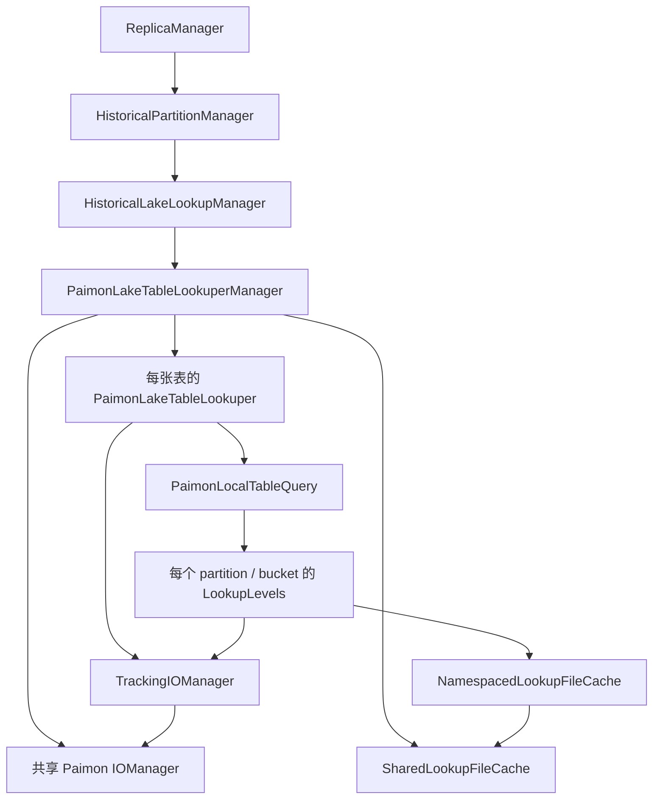
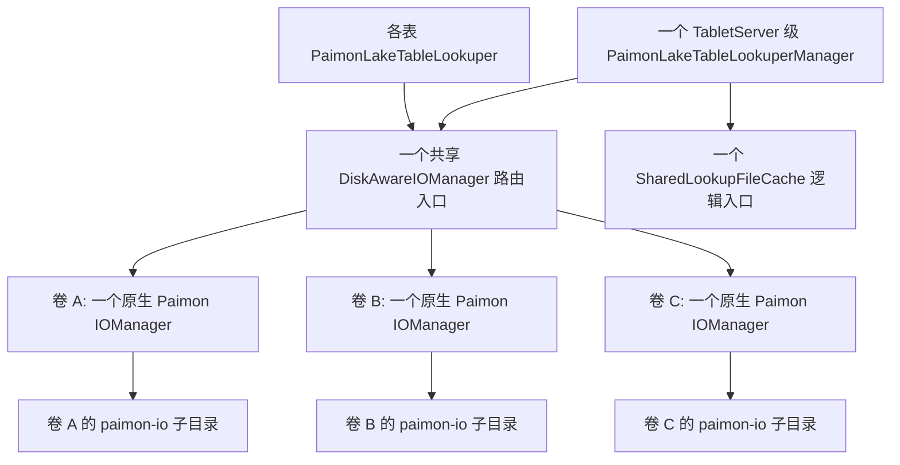

<!-- SPDX-License-Identifier: Apache-2.0
     https://www.apache.org/licenses/LICENSE-2.0 -->
# Historical partition SST lookup 多盘缓存设计
状态：已实现，消融与既有测试回归完成。日期：2026-10-14。

代码基线：当前 Fluss checkout `f5fe4edae`；根 POM 使用 Paimon `2.1.0`。前半部分记录设计与改动前实现；第 11 节记录最终代码、消融实验和验证结果。
## 1. 推荐方案与边界
推荐复用现有 `data.dirs`，在每个可用存储卷上建立缓存根目录，以 **SST 文件**为单位分配到磁盘。保留一个 TabletServer 级共享缓存入口，内部按卷管理容量、淘汰和故障状态。

核心决策：

| 关注点 | 推荐决策 |
| --- | --- |
| 多盘配置 | {==默认使用 LocalDiskManager 已验证的 data.dirs 列表；不增加另一套缓存目录配置==}{>>就默认使用 data.dirs<<}{id="c1" by="user" at="2026-10-14T07:32:22.040Z"}{>>已采纳，缓存直接使用 LocalDiskManager 返回的可用目录列表。<<}{id="c3" by="AI" at="2026-10-14T07:41:49.000Z" re="c1"} |
| 物理范围 | 按实际 FileStore 分组，同卷多个 data dir 只计一次容量，选一个目录承载缓存 |
| 文件分配 | 在可分配卷中选择预计占用比例最低的卷，同分时轮询；同一文件生命周期内固定落盘 |
| 容量管理 | 每卷独立缓存配额，汇总预算为各卷配额之和；下载中、构建中和删除失败的文件也计入物理占用 |
| 写入保护 | SST 缓存使用目标卷的空间检查和预留；普通 KV/log 写入保留当前全局写保护 |
| 故障处理 | 隔离故障卷，失效其缓存，后续 miss 在健康卷重新下载或构建；不复制坏盘缓存 |
| 恢复方式 | 空间压力解除后自动恢复；I/O 故障卷首版通过修复磁盘并重启 TabletServer 恢复 |
| 单盘行为 | data.dirs 只有一条时自然退化为单盘，仍使用相同的容量比例和过期配置 |

范围是 SST lookup 的本地缓存。SCAN lookup、湖存储文件布局、RPC 协议、tablet 的数据分配策略不变。首版不做缓存持久化复用、盘间搬迁、同一 SST 多副本、热点文件条带化、按磁盘性能设权重或动态增删盘。
## 2. 改动前实现梳理（f5fe4edae）
### 2.1 调用链和资源所有权


| 位置  | 当前行为及与多盘的关系 |
| --- | --- |
| [ReplicaManager.java](/Users/zuston/dev/fluss-community/fluss/fluss-server/src/main/java/org/apache/fluss/server/replica/ReplicaManager.java:374) | 取 `localDiskManager.dataDirs().get(0)`，读取该 FileStore 的 `getTotalSpace()`，传入 historical manager |
| [HistoricalPartitionManager.java](/Users/zuston/dev/fluss-community/fluss/fluss-server/src/main/java/org/apache/fluss/server/replica/historical/HistoricalPartitionManager.java:64) | 将单个 `File dataDir` 和 `long dataDirVolumeBytes` 传给 lookup manager |
| [HistoricalLakeLookupManager.java](/Users/zuston/dev/fluss-community/fluss/fluss-server/src/main/java/org/apache/fluss/server/replica/historical/HistoricalLakeLookupManager.java:126) | 持有单个缓存根目录、单个卷容量；启动时清理目录；创建共享 manager；每 3 分钟扫描目录大小 |
| [FlussPaths.java](/Users/zuston/dev/fluss-community/fluss/fluss-common/src/main/java/org/apache/fluss/utils/FlussPaths.java:159) | 缓存根目录是 `${dataDir}/.historical-lookup-cache` |
| [PaimonLakeStorage.java](/Users/zuston/dev/fluss-community/fluss/fluss-lake/fluss-lake-paimon/src/main/java/org/apache/fluss/lake/paimon/PaimonLakeStorage.java:69) | 调用 `IOManager.create(String)`，所有表共用一个 IOManager 和 SharedLookupFileCache |
| [LakeStorage.java](/Users/zuston/dev/fluss-community/fluss/fluss-common/src/main/java/org/apache/fluss/lake/lakestorage/LakeStorage.java:62) | 插件创建接口只接受一个 `String ioTmpDir` |
| [LakeTableLookuperManager.java](/Users/zuston/dev/fluss-community/fluss/fluss-common/src/main/java/org/apache/fluss/lake/lakestorage/LakeTableLookuperManager.java:73) | `LookupCacheOptions` 只有总预算和过期时间；`Context` 通过无参数 `Runnable diskWriteGuard` 做写保护 |
| [PaimonLakeTableLookuper.java](/Users/zuston/dev/fluss-community/fluss/fluss-lake/fluss-lake-paimon/src/main/java/org/apache/fluss/lake/paimon/lookup/PaimonLakeTableLookuper.java:573) | TrackingIOManager 在 `createChannel(prefix)` 前执行全局 guard，并记录当前 lookup 创建过文件；自身 close 不关闭共享 IOManager |
| [PaimonLocalTableQuery.java](/Users/zuston/dev/fluss-community/fluss/fluss-lake/fluss-lake-paimon/src/main/java/org/apache/fluss/lake/paimon/lookup/PaimonLocalTableQuery.java:187) | 将 `IOManager.createChannel(prefix).getPathFile()` 作为 LookupLevels 的本地文件工厂 |
| [SharedLookupFileCache.java](/Users/zuston/dev/fluss-community/fluss/fluss-lake/fluss-lake-paimon/src/main/java/org/apache/fluss/lake/paimon/lookup/SharedLookupFileCache.java:53) | 单个 Caffeine weighted cache，按本地文件 KiB 计权重，访问过期，移除时 `LookupFile.close(cause)` |
| [NamespacedLookupFileCache.java](/Users/zuston/dev/fluss-community/fluss/fluss-lake/fluss-lake-paimon/src/main/java/org/apache/fluss/lake/paimon/lookup/NamespacedLookupFileCache.java:39) | 将文件名映射为 `(namespace, fileName)`，防止不同表或不同 lookuper 实例互相清理 |

`HistoricalLakeLookupManager` 还缓存表级 lookuper；namespace 包含 tableId、schemaId、lake 配置版本和 lookuper 实例序号。旧实例在请求释放后关闭，新旧实例的缓存互不影响。多盘方案必须保留这一约束，不能把 Key 简化成裸文件名。
### 2.2 文件如何产生和读取
本地依赖源码显示，LookupLevels 的 miss 流程如下，可交叉核对 [Paimon LookupLevels](https://github.com/apache/paimon/blob/release-2.1/paimon-core/src/main/java/org/apache/paimon/mergetree/LookupLevels.java) 和 [LookupFile](https://github.com/apache/paimon/blob/release-2.1/paimon-core/src/main/java/org/apache/paimon/mergetree/LookupFile.java)：

1. 读取缓存；未命中时进入文件锁，并再次检查缓存。

2. 从本地文件工厂取得路径，再调用 `File.createNewFile()`。

3. 如果有可用 remote lookup 文件，下载到本地；否则扫描 lake data file，构建本地 SST。

4. 创建 LookupStoreReader，执行本次查询；在 `finally` 中将完整文件加入缓存。

5. 命中时通过 LookupFile 的 reader 查询。文件淘汰时关闭 reader、执行 ownership callback、删除文件。


远端 SST 下载只在 remote lookup 开启、无 deletion vectors、读取完整 value 时启用；projection 等情况下仍可能本地构建 SST。必须同时覆盖两条路径。

**重要边界：IOManager 在这里主要负责路径和目录生命周期，实际文件创建、下载、SST 写入和随机读不通过它的 BufferFileWriter/Reader。** 因此只装饰 `createBufferFileWriter()` 无法实施容量预留，也无法捕获全部本地写失败。

Paimon 原生支持 `IOManager.create(String[])`；FileChannelManager 按文件轮询，并在初始化 channel manager 时跳过无法创建的临时目录。运行中没有容量感知或坏盘摘除。参见 [Paimon IOManagerImpl](https://github.com/apache/paimon/blob/release-2.1/paimon-core/src/main/java/org/apache/paimon/disk/IOManagerImpl.java) 和 [FileChannelManagerImpl](https://github.com/apache/paimon/blob/release-2.1/paimon-core/src/main/java/org/apache/paimon/disk/FileChannelManagerImpl.java)。

以上具体行为以本机 `paimon-bundle-2.1.0-sources.jar` 为准，上游 release 分支用于交叉核对。该源码包 SHA-256：`357c8215f2a2a4851bf8dc5810aa748a6a8604bf834b0dc367c4797d18041383`。
### 2.3 当前容量和失败语义
当前预算为：

```text
Q = max(1, min(T, ceil(T × ratio)))
T = 第一条可用 data dir 所在卷的总容量
ratio = server.historical-partition.lookup-cache.max-disk-ratio，默认 0.10
```

这一预算只约束已放入 Caffeine 的文件。并发下载或构建中的文件尚未入缓存；读请求持有文件时，close 可能等待；删除失败也不代表物理空间已释放。因此 Caffeine weight 和目录实际占用并不等价。

`LocalDiskManager` 已支持 `data.dirs`，启动时剔除初始化失败的目录并加目录锁。[DiskUsageCollector](/Users/zuston/dev/fluss-community/fluss/fluss-server/src/main/java/org/apache/fluss/server/storage/DiskUsageCollector.java) 对 FileStore 去重，取各卷使用率的最大值。达到高水位时，[ensureWritable()](/Users/zuston/dev/fluss-community/fluss/fluss-server/src/main/java/org/apache/fluss/server/storage/LocalDiskManager.java:519) 会锁住整个 TabletServer 的普通写入和新的 SST 缓存文件创建；已有缓存命中不调用 guard。

[lookupPaimon()](/Users/zuston/dev/fluss-community/fluss/fluss-lake/fluss-lake-paimon/src/main/java/org/apache/fluss/lake/paimon/lookup/PaimonLakeTableLookuper.java:450) 对 IOException 刷新 bucket 文件列表后重试一次，最终包装为 KvStorageException。但 **刷新远端元数据不会自动移除一个本地 reader 已损坏、远端元数据未变的缓存条目**。

另外，RemoteLookupFileManager 的 `tryToDownload()` 捕获 Exception 后返回 false，随后转为本地构建。这会把本地磁盘写失败和远端下载失败混在一起，故障设计需要补充明确的本地错误边界。
## 3. 多盘配置与目录初始化
### 3.1 复用现有配置
配置兼容性 Review：{>>不用考虑旧配置的兼容性<<}{id="c2" by="user" at="2026-10-14T07:33:53.518Z"}{>>已采纳，移除旧配置示例，不额外设计缓存侧的旧配置解析或迁移。缓存只消费 LocalDiskManager 已解析的目录列表；单条 data.dirs 自然支持单盘。<<}{id="c4" by="AI" at="2026-10-14T07:41:49.000Z" re="c2"}

```yaml
# 多盘配置：所有可用且属于不同卷的目录参与 SST 缓存
data.dirs: /disk1/fluss,/disk2/fluss,/disk3/fluss
server.historical-partition.lookup-cache.max-disk-ratio: 0.10
server.historical-partition.lookuper-cache.expire-after-access: 3 h
server.data-disk.write-limit-ratio: 0.85
server.data-disk.write-recover-ratio: 0.80
server.data-disk.check-interval: 30 s
```

默认使用 `data.dirs` 对应的可用目录列表，只有一条时就是单盘。缓存侧不新增旧配置兼容逻辑；LocalDiskManager 如何解析其输入保持现有职责。已配置多条目录的部署，升级后缓存会开始使用其他卷，预算随之增加；这是需在发布说明中明确的行为变化。

首版不支持缓存专用外部目录或人工权重。这样可复用现有目录锁、serverId 和磁盘初始化流程，也不会引入另外一套目录优先级与容量配置。
### 3.2 按卷建模
输入应来自 `LocalDiskManager.dataDirs()` 的可用目录，而不是直接读取未验证的配置字符串。

| 字段  | 含义  |
| --- | --- |
| volumeId | 进程内唯一的卷标识；不直接使用 FileStore 名称作为唯一键 |
| dataDirs | 属于同一 FileStore 的已验证目录 |
| cacheRoot | 选该组第一条可用目录下的 `.historical-lookup-cache` |
| totalBytes | 该卷总容量，只计一次 |
| maxCacheBytes | 由统一 ratio 计算的每卷配额 |
| state | 可读可写状态；FAILED 在本次运行中保持隔离 |

首先复用 DiskUsageCollector 的 FileStore 去重方式，并在 Linux 实盘测试中验证 bind mount、同卷不同路径的识别；不能仅凭路径不同就认定有两块盘。FileStore 是配额与故障管理单位，它不保证底层物理设备互不共享。

初始化每个卷时，在已有 data dir 锁保护下清理该组目录内遗留的 `.historical-lookup-cache`，再创建本次使用的根目录。清理范围仅限缓存子目录。无法安全清理的卷应不参与本次缓存分配，遗留文件作为 orphan 记录；其他健康卷可以继续工作。

同一卷只创建一个 Paimon IOManager delegate，并主动验证临时子目录，避免直到首次 lookup 才暴露目录不可用。若 data dirs 可用但所有缓存根都初始化失败，记录缓存不可用状态，允许其他 TabletServer 功能启动，SST miss 按第 6 节报错；不能把空数组传给 Paimon IOManager。路径保持：

```text
/disk1/fluss/.historical-lookup-cache/paimon-io-<uuid>/<prefix>-<random>.channel
/disk2/fluss/.historical-lookup-cache/paimon-io-<uuid>/<prefix>-<random>.channel
```

文件内容是 lookup SST，扩展名仍由 Paimon channel 生成。目录列表改变通过重启生效；ratio、过期时间和现有磁盘水位配置继续支持动态调整。

### 3.3 IOManager：每盘一个，还是一个初始化多盘？

**推荐每个独立卷持有一个原生 Paimon IOManager，外层只有一个共享的 DiskAwareIOManager 路由入口。** N 表共享该入口；这里的每盘是按 FileStore 去重后的卷，不是每个配置路径，也不是每张表一个。

先明确改动前代码的数量：PaimonLakeTableLookuperManager 创建 **1 个原生 IOManager**，各表的 TrackingIOManager 只是统计装饰器，全部委托给它。当前只用一个盘的原因是创建它时只传了一个目录。

两种候选方式分别是：

```java
// A：每卷一个原生实例，由共享路由入口协调
delegates.put(volumeA, IOManager.create(cacheRootA));
delegates.put(volumeB, IOManager.create(cacheRootB));

// B：一个原生实例持有多个目录
IOManager ioManager = IOManager.create(new String[] {cacheRootA, cacheRootB});
```

| 评估项 | A：每盘一个原生 IOManager | B：一个原生 IOManager 初始化多盘 |
| --- | --- | --- |
| 默认分配 | 路由入口选盘，单盘 delegate 只产生该卷内的路径 | 原生 createChannel 在初始化成功的目录间轮询 |
| 指定目标盘 | `delegates.get(volumeId).createChannel(prefix)`，直接使用原生 API | 原生 API 没有指定目录/卷参数；要覆写路径分配或自行构造目标目录下的 channel ID |
| 容量管理 | 仍由分配器和每卷缓存账本负责 | 同样需要额外账本，多目录初始化不提供每盘配额 |
| 运行中排除坏盘 | 从候选集合移除该 delegate，其他 delegate 保持不变 | 原生内部 paths 初始化后固定，需由自定义选盘逻辑过滤，不能继续调用原生轮询 |
| 逐盘关闭/目录清理 | 在该盘请求退出、缓存 reader 关闭后，对其 delegate close | 原生 close 清理全部目录，没有单盘 close；需要自管逐目录清理和关闭流程 |
| 实际 SST 读写故障 | 通过 SST stream/reader 捕获，不能仅靠 delegate | 同样需要 SST stream/reader 的故障归因 |
| 常驻开销 | N 份轻量目录管理状态和随机数/计数器 | 一份目录管理状态，持有 N 个路径 |
| I/O 线程与 FD | IOManager 不自带每盘线程池，也不持有全部 SST reader；FD 由实际 reader/stream 持有 | 相同；没有因为只用一个 manager 就减少 SST reader 数量 |
| 达成本文完整目标的改动 | 一个薄路由器，复用原生单目录分配和 close | 一个定制多盘实现，维护卷与真实 spill path 的映射，并接管分配和逐盘清理 |

原生多目录实现的轮询和全目录 close 可见 [FileChannelManagerImpl](https://github.com/apache/paimon/blob/release-2.1/paimon-core/src/main/java/org/apache/paimon/disk/FileChannelManagerImpl.java)。IOManagerImpl 的目录管理是懒初始化的，BufferFileReader/Writer 则按传入 channel ID 单独创建；参见 [IOManagerImpl](https://github.com/apache/paimon/blob/release-2.1/paimon-core/src/main/java/org/apache/paimon/disk/IOManagerImpl.java)。

如果目标只是把等容量、健康磁盘上的新文件摊开，B 只需传数组，改动最少。本文还要求按目标盘的空间和健康状态选择、独立清理故障盘；在这个范围内，A 能直接组合现有 API，少依赖 Paimon 内部 spill path 和 channel ID 的构造细节，因此推荐 A。

一个自定义的多盘 IOManager 也可以完成这些要求，但不能将它等同于简单调用 `IOManager.create(String[])`。若选择 B 的定制版本，可从公开的 getSpillingDirectories 获取实际子目录，覆写 createChannel 选择目标卷，并实现状态过滤和逐卷 cleanup；这部分代码承担的职责与 A 的路由器接近，且需要同时验证 Paimon 原生目录生命周期。

不建议循环调用原生 createChannel，直到轮询恰好命中目标盘，也不应在运行中重新创建全局 manager 以移除坏盘；后者会影响其他卷现有路径的生命周期。

推荐的实例与调用关系为：



miss 时先由分配器登记 allocation，路由入口根据 allocation 的 volumeId 调用对应 delegate；它不能再次独立选盘。已有文件的读由 LookupFile 的本地路径和 reader 完成，不需要每次命中都经过 IOManager 选盘。

因此准确的数量是：**1 个共享缓存运行时，1 个 IOManager 路由适配器，N 个原生 Paimon IOManager，统计和写保护保存在每次请求的 LookupScope 中；不再为各表创建 TrackingIOManager。** 只有一块卷时 N=1。多个 delegate 带来的是目录分配和生命周期边界，容量和真实 I/O 故障隔离仍由本文其他组件完成。

单盘失败时先停止向它分配、使其缓存不可见，最后等待该盘 in-flight 操作退出再关闭 delegate；不能调用共享路由入口的全局 close 来处理单盘故障。关闭 delegate 前仍须验证挂载身份，避免清理错误文件系统上的同名路径。

## 4. SST 文件分配
### 4.1 选择文件粒度
不按 table、partition 或 bucket 固定绑定磁盘。单个历史分区可能很大，按分区绑定会让热点和缓存容量集中到一块盘。文件粒度能让同一分区的多个 SST 利用多盘。

不对缓存 Key 做固定 hash 路由：缓存不跨重启复用，固定归属的价值有限，且容量不均或磁盘失效时还需要再设计溢出规则。读取位置由已有缓存条目和本地路径记录，命中时无需重新选盘或扫描磁盘。
### 4.2 分配规则
候选卷必须可分配、挂载身份有效、具备所需的物理空间预留。对候选卷计算：

```text
score_i = (residentBytes_i + buildingBytes_i + reservedRemainingBytes_i
           + orphanBytes_i) / maxCacheBytes_i
```

选择预计占用比例最低的卷；同分时轮询。完成一次选择后，立即登记文件 allocation 和预留，使其他线程能够看到本次占用。选择与登记使用短临界区，不能在其中读取远端、关闭 reader 或删除文件。

1 TiB 与 2 TiB 的卷，在相同 ratio 下分别得到约 102.4 GiB 与 204.8 GiB 配额；按比例平衡有利于让它们承载约 1:2 的缓存字节。它不保证 IOPS 比例或单个热点 SST 的负载均衡。

每个 allocation 至少包含：`namespace`、原始文件名、目标 volumeId、本地路径、已写字节、剩余预留和终结状态。文件创建成功后固定落盘；遇到本地故障时废弃旧 allocation，并在其他卷开始一个新 allocation。

远端 lookup 文件优先从远端 file status 获取完整长度，可复用已有元数据；不能把 data file 的大小当成 SST 大小。长度未知时按小块增量预留，内部初始块建议 8 MiB，并随写入扩展。8 MiB 是实施时可调整的内部常量，不增加用户配置。
### 4.3 接入实际创建流程
Paimon 的 `LookupLevels.createLookupFile(DataFileMeta)` 是 public 且可覆写。建议在现有 PaimonLocalTableQuery 内接入一个小型派生类：

1. 进入 createLookupFile 时获取 allocation；调用原创建逻辑，保留 Paimon 的序列化、schema 和 reader 行为。

2. 本地文件工厂通过当前 allocation 调用目标卷的 IOManager delegate，而不再自行轮询。

3. 完整文件进入缓存时，将 building 记账转为 resident；失败时清理文件并幂等终结 allocation。


受现有 `Function<String, File>` 签名限制，allocation 可通过严格限定在一次同步创建中的 ThreadLocal 传递；必须在 finally 中移除，并测试异常后线程复用。不要通过解析文件 prefix 来推导 table 或磁盘身份。

下载和本地构建分别接入受控输出流。Paimon 2.1.0 的 SortLookupStoreWriter 已有接收 PositionOutputStream 的 public 构造器，可以用一个小型 LookupStoreFactory adapter 复用 writer/reader；remote downloader 则适配复制循环和本地异常传播。无需改 Paimon 依赖版本，也无需复制整个 LookupLevels。

消融后已移除 TrackingIOManager，当前请求的“创建过 lookup 文件”统计和写保护并入 LookupScope，保留原统计语义。缓存分配保护覆盖有 prefix 和无 prefix 的创建入口；不允许从 pickTempDir 或 channel enumerator 绕过预留。SST 路径未使用的接口应明确限制用途并用测试约束。
## 5. 容量管理
### 5.1 配额按卷计算
```text
Q_i = max(1, min(T_i, ceil(T_i × ratio)))
Q_total = sum(Q_i)，每个独立 FileStore 只出现一次
```

原 ratio 的含义扩展为“每个参与缓存的卷允许用于常驻缓存的最大比例”。一块盘的计算方式与当前一致；同一 FileStore 上配置多个目录不会放大配额。

不把坏盘的预算转给其他盘。例如两个卷各有 100 GiB 缓存配额，一块失效后可用缓存配额为 100 GiB，不能让剩下的一块承载 200 GiB。
### 5.2 一个共享缓存，加每卷配额

最终实现复用一个 SharedLookupFileCache 和现有 NamespacedLookupFileCache。Caffeine 的全局权重上限与冷热顺序继续保留；每卷通过 retainedBytes 限制逻辑保留的文件总量，只从该卷的冷文件中回收超额部分。

不额外维护 `(namespace, fileName) -> disk` 索引：缓存命中直接使用既有 Caffeine 中的 LookupFile 和 reader。`File -> Allocation` 注册表负责实际路径对应的预留、FD 和物理占用生命周期；它还覆盖构建中、已从缓存摘除及删除失败的文件，因此不能由 Caffeine 替代。

淘汰先撤销逻辑保留的字节计数，再把物理关闭交给每卷合并的 I/O 任务，避免坏盘 reader 把共享缓存锁占住。residentBytes 在 reader 关闭和删除确认前继续计费。显式关闭表级 lookuper 时，在缓存锁外同步关闭该实例拥有的文件；保持既有关闭语义。

Paimon 原有的 filename-only ownership callback 不负责跨实例清理。派生 LookupLevels 使用实例级 ownedFiles，并以文件实例进行条件移除，避免旧文件的延迟关闭抹掉新文件记录。

### 5.3 物理占用和缓存权重分开记账
| 账目  | 内容  | 释放时机 |
| --- | --- | --- |
| residentBytes | 已完成文件，包含已摘除但 reader 尚未关闭的文件 | 确认删除后；不能在逻辑淘汰时提前扣除 |
| buildingBytes | 活跃下载或构建已落地的字节 | 转入 resident，或确认失败文件已删除 |
| reservedRemainingBytes | 对后续写入已预留、尚未落地的字节 | 写入后转为 building，或 allocation 结束 |
| orphanBytes | 删除失败、启动残留等无法立即清理的文件 | 后续清理确认成功后 |

目录扫描用于校准账本和发现残留，不作为每次分配时唯一的保护机制。保留现有 3 分钟占用统计周期，逐卷扫描；一个卷扫描失败只标记该卷采样过期，不能把它当成 0 字节或阻断其他卷统计。
### 5.4 写入预留与磁盘水位
常驻缓存配额和可写物理空间是两件事：`Q_i` 控制保留多少完整文件，磁盘水位和预留控制本次能否继续写入。建议复用现有高低水位 `H=0.85`、`L=0.80`。

```text
可用于本次新增写入的空间
  = usableSpace_i - (1 - H) × totalSpace_i
    - outstandingReservedBytes_i - filesystemSafetyMargin
```

预留时在每卷短锁内获取有效的空间检查并登记预留，避免多个下载线程重复承诺同一块可用空间。写入前扩展预留；写入完成后将对应预留转为已落地字节。不能同时把同一段数据计入 building 和 remaining reservation。

filesystemSafetyMargin 用于块分配、元数据等误差，建议至少保留一个预留块；具体值在实盘验收中校准。高水位为 1.0 时保留原“关闭比例写保护”的含义，但仍检查实际可用空间和并发预留。

预留不足先回收目标卷的冷文件，实际删除后重新检查；无法满足时选其他卷，全部不足则返回可重试的空间保护错误。pressure 清理应在现有 I/O executor 上执行，避免占用调度线程。普通数据写入仍可能与缓存并发消耗空间，因此预留不能保证其他写入方不会导致 ENOSPC；实际写失败必须进入空间压力处理。

受控输出流必须覆盖 remote copy 的每个 write，以及本地 SST writer 的数据块、BloomFilter、索引、footer 和 close-time flush。只在 writer.put() 前检查文件大小会漏掉关闭时的大块写入。
### 5.5 大文件与动态调整
**超过所有卷常驻配额的单个 SST，允许在物理空间足够的健康卷临时构建，完成当前查询后不入缓存并删除。** 当前 Paimon 已先查询再 put，因此可在 put 时决定拒绝保留。这样不会因为预算小于单文件大小而破坏原单盘的查询能力；代价是后续请求需要重新构建。

临时文件同样占用 building、预留和删除期间的 resident/orphan 账本，并受水位保护。不得使用配额为 0 的 Caffeine 或虚构 1 字节预算来表示“没有可用磁盘”。

ratio 缩小时更新每卷配额，只淘汰各自超额文件，不替换表级 lookuper；读者占用或删除失败期间允许实际空间暂时高于新预算，并由账本反映。ratio 增大不搬文件；新的 miss 自然填充。过期时间继续分别按 lookuper 和文件的访问更新。
## 6. 磁盘故障和降级
### 6.1 状态与动作
| 状态  | 已有缓存读 | 创建新文件 | 主要动作 |
| --- | --- | --- | --- |
| HEALTHY | 允许  | 允许，仍需预留 | 正常分配 |
| PRESSURED | 允许  | 停止，切换其他卷 | 异步清理冷缓存；使用率降到 L 后恢复 |
| FAILED | 停止  | 停止  | 停止分配和缓存读，后台清理；修复后重启恢复 |

实际实现对 FileNotFoundException / EOFException 的读错误只失效具体文件；其他本地读 I/O 失败隔离该卷。写失败先结合目标卷空间检查归因，空间不足进入 PRESSURED，其余本地 I/O 失败进入 FAILED。首版不提供 FAILED 在线重新接入，因此没有单独的 generation 字段或 SUSPECT 状态。

磁盘状态和预算更新需保证并发可见；高低水位来自同一个不可变配置快照。逻辑隔离在请求线程快速完成；关闭多个 reader、递归清理目录放到现有 I/O executor。每卷最多一个维护任务，不能持有全局锁等待坏盘 I/O。

首版对 FAILED 不做在线自动重新接入，减少挂载变化和残留文件复用风险。PRESSURED 的自动恢复沿用高低水位滞回，不把瞬时空间不足永久当成坏盘。
### 6.2 错误分类
| 错误  | 分类与处理 |
| --- | --- |
| 目标卷无空间、预留失败 | PRESSURED；先清理该卷，再尝试其他卷；保留有效命中 |
| 本地创建、写、读报告 EIO 或只读 | 隔离该卷；失效该卷所有缓存；在健康卷重新开始 |
| 单个缓存文件丢失、可确认的内容损坏 | 条件移除具体条目；卷探测正常时不整盘失效 |
| 远端对象丢失或 snapshot 已变化 | 保留现有元数据刷新和一次重试逻辑；不标坏本地盘 |
| 远端超时、权限或网络错误 | 走远端失败路径；不修改磁盘状态 |
| 删除失败 | 残留记 orphan、告警并后续清理；不提前宣告空间释放 |

不能只凭 IOException 的 message 判断 errno。优先通过明确的本地 open/read/write/close 边界捕获，携带 `volumeId、localFile、operation、cause`；无法归因的异常通过探测补充证据，不直接判整盘失效。

remote downloader 遇到远端读取失败时可保留原构建 fallback；遇到受控本地输出失败时必须传播携带磁盘身份的异常，不能返回 false 后继续在同一坏盘构建。其接口不声明 IOException，可使用明确类型的 UncheckedIOException，进入重试边界后解包。
### 6.3 命中失败后的有界重试
新增 CacheDiskIOException 或等价内部错误类型，在 reader adapter 捕获本地异常时生成。错误中必须含原 LookupFile 身份或 allocation id，避免“移除同名条目”误删并发产生的新文件。

调整现有 lookupPaimon 的重试分类：

1. 本地文件读失败：先条件失效出错条目；若卷失效则过滤该卷全部条目，再在健康卷重试该次 lookup。

2. 本地文件创建/写失败：allocation 废弃并清理，在另一个候选卷重新开始；保留同一份 DataFileMeta，不因此刷新远端 snapshot。

3. 普通远端 IOException：刷新该 bucket 文件列表后重试一次。

4. 空间保护失败：尝试当次尚未尝试的可用卷；全部不足则保留 DiskWriteLockedException 或兼容的可重试错误。


共享一次调用的重试预算：每个候选卷最多一次分配尝试，最多一次远端元数据刷新；本地 retry 不重复嵌套到原“任意 IOException 再试一次”路径中。数据文件列表因刷新变化后也不能重置已尝试卷集合，避免 N 盘和远端失败形成乘法重试。

只有完整文件和可读卷才能入缓存。写到一半时失败，或构建完成前该卷已隔离，都不得发布文件。缓存读在 FAILED 卷上会报告可归因的 I/O 错误；磁盘失败不能变成“查无此 key”的 null 结果。

全部缓存卷不可用时，SST cache miss 返回可重试 KvStorageException，空间压力保留磁盘写保护错误；服务端和客户端已有有界重试仍应遵守请求期限。不自动切换表的 SCAN 模式。SCAN lookup 可继续按自身路径执行。
### 6.4 挂载丢失和慢盘
保存启动时卷身份，创建文件前确认目标根目录仍在预期卷上；不能在挂载消失后自动 mkdir 并写入根分区。复用现有 disk.properties 与目录锁作为所有权约束，但它们不是可靠的运行时挂载检测。

已挂载磁盘在进程启动前消失时，当前 LocalDiskManager 可能先创建目录，这一既有风险无法仅由缓存分配器识别；部署需确保 data dirs 的挂载有效性，或另行增加持久化的设备身份校验。本文的运行时校验不应被宣称为已解决启动前的挂载缺失。

本地同步文件 I/O 可能被内核长时间阻塞，Java interrupt 不保证能取消。该方案能在得到错误或有效探测结果后隔离，不保证对任意硬件挂死即时恢复；这也是故障实盘验收需单独观察的场景。
## 7. 模块边界和接口改动
所有新增类型都留在 Fluss 的模块层次内，fluss-common 不引用 LocalDiskManager 或 Paimon 类型。

| 层   | 职责  |
| --- | --- |
| fluss-server | 从 LocalDiskManager 可用目录发现卷；初始化和清理缓存根；维护每卷磁盘状态、水位与挂载身份；提供 I/O executor 和指标采样 |
| fluss-common | 定义格式无关的磁盘描述、访问回调和多盘运行时创建接口 |
| fluss-lake-paimon | 一个共享 DiskAwareIOManager 路由入口与每卷原生 delegates、文件分配及预留账本、按卷缓存、受控 SST 输入输出、带归因信息的错误和缓存失效 |

实际接口复用现有 LookupCacheOptions，加入不可变的“绝对缓存目录 -> 配额”映射与高低水位；新工厂直接接受 options 和 Executor。不引入 LookupCacheRuntime、CacheDiskAccess 或额外公共磁盘 DTO。

LakeTableLookuperManager 的 retain() 返回标准 AutoCloseable。HistoricalLakeLookupManager 在生命周期锁内获取租约，在锁外执行整个 lookup 批次，批次结束后释放。单个 key 的 LookupScope 负责重试范围、文件创建统计和写保护；单个 Allocation 负责文件和预留生命周期。

PluginLakeStorageWrapper 已代理新工厂、retain、检查与指标接口，并保留插件 classloader 上下文。

LocalDiskManager/DiskUsageCollector 可增加输出每卷采样快照的接口，global max 和普通写锁仍保持现有语义。采样不到的卷显式标记 unavailable/stale；不能因为现有 collector 跳过失败卷而把它认为健康。

单盘旧接口没有 server volume runtime 时，仍可以使用原 Runnable guard；新路径以每卷 guard 代替。多盘下 A 盘空间压力导致普通写入全局锁住时，SST 缓存仍允许在健康 B 盘创建，这是本方案有意改变的缓存保护范围。
## 8. 生命周期和可观测性
启动清理覆盖所有选定目录，但只在对应卷身份和目录所有权有效时进行。关闭时停止新 allocation，等待在途构建与读者释放，关闭缓存 reader，最后关闭该卷的 IOManager delegate。单盘失效不得 close 整个共享 manager。

当前 HistoricalLakeLookupManager.close 会关闭共享 manager，即使失效的旧 lookuper 仍有 active lookup；现有测试也覆盖了这一行为。多盘实现不能直接假设生命周期已满足接口文档，应增加 manager 级在途引用/延迟关闭，在最后一个在途请求和构建退出后释放 delegates；停止流程仍受服务器退出期限约束。

保留历史缓存总占用、表数量和容量淘汰总数指标，增加按 volumeId 的子指标：

| 指标  | 用途  |
| --- | --- |
| 配置/有效缓存预算、resident/building/reserved/orphan bytes | 解释“缓存权重较小但盘仍满” |
| volume state 与采样有效性 | 判断坏盘、空间压力和过期采样 |
| 文件分配数、下载/构建字节 | 证明多个卷实际参与缓存 |
| capacity/pressure/failure 淘汰计数 | 区分正常替换和故障 |
| 本地读写失败、分配切换、临时大文件计数 | 发现坏盘、预算不足及不可缓存的大 SST |

指标标签使用有限的卷 ID，路径放日志中；不要给每个文件名加标签。原“创建过文件”指标维持兼容，不能因它名字包含 downloaded 就把本地构建误认成纯远端下载统计。
## 9. 实施顺序与验证
### 9.1 三个可审查阶段
1. **多盘 plumbing 和分配**：去掉 ReplicaManager 的第一盘假设，增加兼容 overload、wrapper 代理和卷去重；按卷 IOManager 与文件位置索引接入。此阶段只完成内部功能，不作为具备故障隔离的版本发布。

2. **容量与并发**：每卷配额、完整 allocation 生命周期、实际输出流预留、临时大文件、删除失败账本、动态 ratio/过期调整。

3. **故障和验收**：逐卷状态、条件失效、远端/本地错误区分、有界切盘重试、挂载校验、延迟关闭和指标。


预计触及 fluss-common、fluss-server、fluss-lake-paimon，多于 5 个文件。本文阶段只提交设计文件；实际实施应以 review 后确定的范围推进。
### 9.2 测试矩阵
| 场景  | 必须验证的结果 |
| --- | --- |
| 单条 data.dirs | 单卷只有一个原生 delegate；路径、预算、namespace、过期和动态配置正确 |
| 多条 data dirs 同 FileStore | 只计算一次配额，不把同盘路径当作多盘容量 |
| 两个等容量卷 / 不同容量卷 | 新文件都能分配；足够多文件下字节占用比例趋于预算比例 |
| 大小不同的 SST / 热点分区 | 按文件而非分区分配；单文件热点限制明确 |
| 多线程 miss 与相同文件 miss | 遵守现有文件锁；预留无重复承诺；异常后无 ThreadLocal 或 allocation 泄漏 |
| 本地构建和 remote SST 下载 | 数据块、footer/flush 都经过预留；仅完整文件可见 |
| ratio 缩小、访问过期、关闭 namespace | 只移除正确文件，不替换活跃 lookuper，不干扰其他 namespace |
| 超大文件 > 所有 Q_i | 物理空间足够则完成一次 lookup 后删除；不反复驱逐整个缓存再保留该大文件 |
| 淘汰与活跃 read 并发 | read 可完成；删除前不释放物理账目；无跨锁死锁 |
| 旧文件延迟 close，新副本已在另一盘 | 索引和 Paimon ownership callback 不误删新副本 |
| 一盘高水位、另一盘健康 | 前者停止新增并回收，后者可填缓存；高低水位滞回有效 |
| 创建/写/读故障与删除失败 | 健康盘接替，坏盘不能重新入缓存，残留计费 |
| 远端 timeout / object missing | 不标坏本地盘；原 bucket refresh 行为保留 |
| 全部盘压力或失效 | 返回正确可重试错误，不能返回 null 或隐式改 SCAN |
| 挂载身份变化 | 停止分配，不在根分区重新创建缓存目录 |
| manager 关闭、在途任务及动态配置并发 | 资源延迟关闭且幂等，无共享 delegate 提前释放 |

单元测试通过可注入的 volume 状态、容量与 I/O 故障验证；两个普通临时目录通常位于同一卷，不能用它们证明真实多盘。集成验收使用两个独立文件系统或可控 loopback mounts，分别测缓存 miss 吞吐、命中 P95/P99、物理占用、故障切换以及恢复后的冷启动成本。

优先扩展现有 HistoricalLakeLookupManagerTest、SharedLookupFileCacheTest、PaimonLakeTableLookuperTest 和 HistoricalPartitionITCase，新增分配器与流预留的集中测试。实现阶段运行 common/server/paimon 相关测试、Spotless、Checkstyle 与 license 校验；本次仅做源码和方案校验，不运行构建测试。
## 10. Review 重点
建议主要确认下面三项取舍，其余细节按上述契约实施：

1. **配置范围**：直接让已配置的所有 data 卷参与缓存，首版不增加缓存专用目录选项。

2. **容量策略**：每卷按统一 ratio 分配配额，内部独立淘汰；超大 SST 允许临时使用后删除。

3. **故障恢复**：空间压力自动恢复；确认 I/O 故障后隔离到下次重启，首版不做在线重新接盘。


核心验收标准是：多个独立卷实际承载 SST，单盘不会超额借用其他盘预算，本地坏盘不会被误判成远端失败或查无数据，单条 data.dirs 自然支持单盘。


## 11. 最终实现与消融实验

本次没有新增或修改测试用例。

| 代码位置 | 最终职责 |
| --- | --- |
| [DiskAwareIOManager.java](/Users/zuston/dev/fluss-community/fluss/fluss-lake/fluss-lake-paimon/src/main/java/org/apache/fluss/lake/paimon/lookup/DiskAwareIOManager.java) | 每卷原生 IOManager、按占用比例选盘、预留与物理账本、独立维护任务、资源租约、状态指标 |
| [LookupFileIO.java](/Users/zuston/dev/fluss-community/fluss/fluss-lake/fluss-lake-paimon/src/main/java/org/apache/fluss/lake/paimon/lookup/LookupFileIO.java) | SST 本地构建/下载共用的受控输出流，本地读写错误归因，footer flush 失败时确保关闭流 |
| [PaimonLocalTableQuery.java](/Users/zuston/dev/fluss-community/fluss/fluss-lake/fluss-lake-paimon/src/main/java/org/apache/fluss/lake/paimon/lookup/PaimonLocalTableQuery.java) | 通过派生 LookupLevels 接入文件生命周期和实例级 ownership |
| [HistoricalLakeLookupManager.java](/Users/zuston/dev/fluss-community/fluss/fluss-server/src/main/java/org/apache/fluss/server/replica/historical/HistoricalLakeLookupManager.java) | FileStore 去重、同卷所有历史缓存根的启动清理、每卷预算、整个批次的资源租约 |

| 实验 | 变化 | 结果 |
| --- | --- | --- |
| B0 | 完整实现基线 | 70 个既有用例通过；完整依赖链编译通过 |
| A1 | 删除 TrackingIOManager、重复缓存引用与统计 ThreadLocal；并入 LookupScope | 对比文件减少 76 行，35 个既有 Paimon/缓存用例通过 |
| A2 | 合并水位状态为配置快照；移除无用 release 参数和具体 IOManagerImpl 依赖；补齐拓扑校验与错误说明 | 35 个既有 Paimon/缓存用例通过；最终对比 B0 净减少 58 行 |
| A3 | 暂时移除全局权重与 weigher | 6 个既有缓存用例中 3 个失败，证明跨 namespace 容量契约和淘汰机制仍需要它；已完整恢复 |

行数统计对比同一组 5 个涉及消融的完整 Java 文件：B0 2638 行，最终 2580 行；包含注释和格式化。它不代表整个补丁新增行数，也不把删除必要校验当作收益。

最终 common / server / paimon 的定向 verify 已通过（70 个不同的既有用例，Maven 的 test 与 integration-test 执行阶段各运行一次），并通过对应模块的 Spotless 和 Checkstyle。没有进行真实多盘故障注入或吞吐压测。

实验日志与基线源码保存在本机 `/tmp/fluss-multidisk-ablation/`，不提交到仓库。Maven wrapper 的分发包校验失败，本次使用本机 Maven 3.9.9 和 JDK 11；清理旧 client 编译产物后完整构建成功，未修改构建配置或依赖版本。
